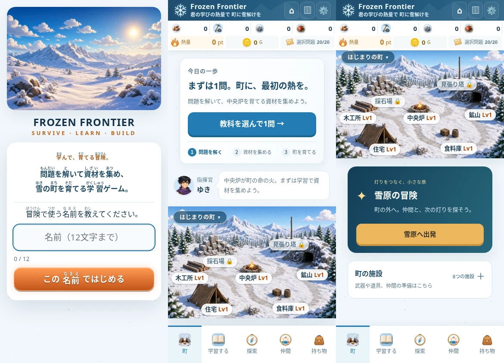
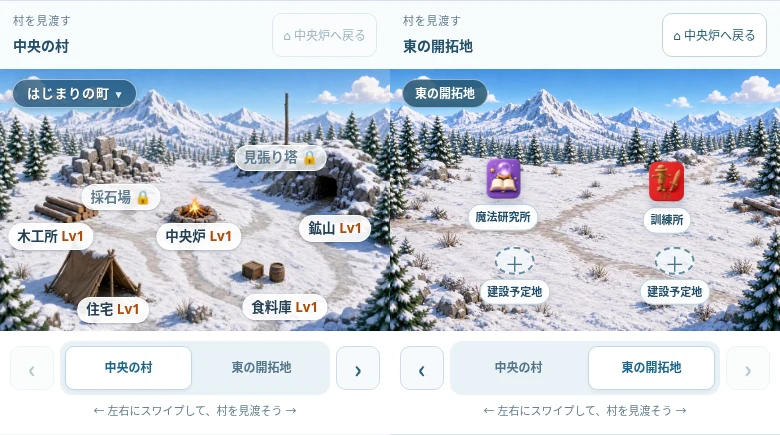
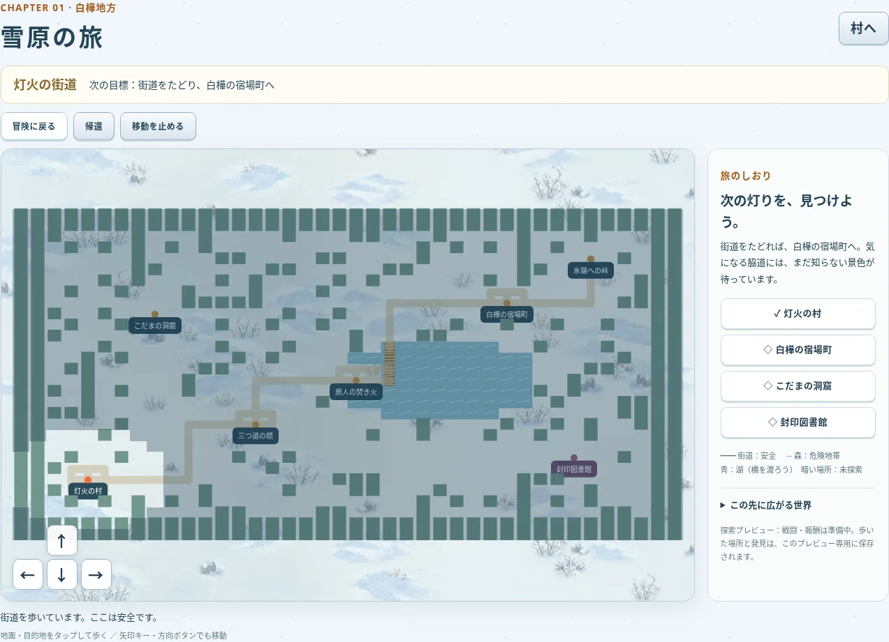
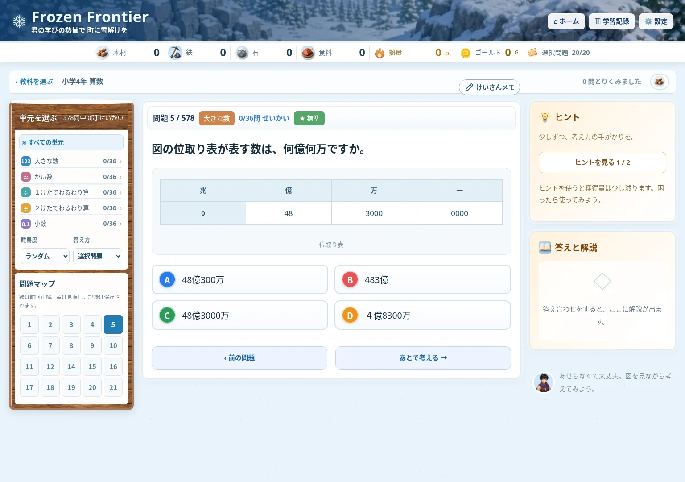

# ChatGPT 案：トップページの比較用レプリカ

Claude Codeでの再開手順・最新仕様は [引き継ぎ文書](../../HANDOFF_CLAUDE_CODE.md) を参照してください。

現在のゲーム（main の e15e2cb）を元に、タイトル・町画面の見せ方を調整した、操作できる試作です。画面変更はこのフォルダーの入口だけで適用します。例外として、問題の品質・難易度修正は本体の `js/generators.js` と `questions/math_g5_hand.js` に適用しています（末尾参照）。

左から、タイトル・町の上部・下へスクロールした冒険の入口（スマホ390px）。



## 開く

リポジトリ直下でサーバーを起動します。

```sh
python3 -m http.server 8772 --bind 127.0.0.1
```

- ChatGPT 案：<http://127.0.0.1:8772/codex-prototypes/homepage/>
- 元の画面：<http://127.0.0.1:8772/>

最初は名前・学年・主人公を選びます。学習、町の建物、冒険、施設は本体の処理で動きます。

試作用の保存キーは `frozenFrontier.prototype.homepage.v1`。本体の保存キーと旧セーブを読み込まず、サーバー同期は無効です。試作をリセットするときは、試作内の「設定」から行います。

## 変更したこと

1. 下部ナビを「町・学習する・探索・仲間・持ち物」の5つへ整理。設定は上部から開きます。
2. スマホの「雪原へ出発」を説明の下の全幅ボタンへ変更。文字が縦に折り返される問題を解消します。
3. 初回の町画面に「問題を解く → 資材を集める → 町を育てる」を表示。学習ボタンを上部にまとめ、指揮官の言葉も次の行動につなげます。
4. タイトルに「問題を解いて資材を集め、雪の町を育てる学習ゲーム」という説明を追加します。
5. 8つの施設を開閉式の「町の施設」にまとめます。中央炉がLv2以上になると、初回向けの3ステップは外し、施設を開いて表示します。
6. 村の表示枠はそのままに、横へ移動できる地図を追加。「中央の村」と「東の開拓地」をスワイプ／マウスのドラッグで見渡せます。矢印、地区のミニマップ、「中央炉へ戻る」でも移動できます。

`design.js` は既存の描画処理を呼び出し、作成された要素を配置し直します。施設のボタンを作り直さず移動するため、既存の操作を引き継ぎます。新しい文言も本体のふりがな処理を通します。

## 更新・検証

本体のスクリプト一覧が変わったときは、入口を再生成します。

```sh
node codex-prototypes/homepage/build-entry.cjs
node tests/run.js
FF_TEST_ORIGIN=http://127.0.0.1:8772 FF_BROWSER_PATH=/usr/bin/chromium node tests/ui-homepage-replica.cjs
FF_TEST_ORIGIN=http://127.0.0.1:8772 FF_BROWSER_PATH=/usr/bin/chromium node tests/ui-village-map.cjs
```

Playwright と Chromium が必要です。環境に応じて `FF_PLAYWRIGHT_MODULE`・`FF_BROWSER_PATH`・`FF_QA_OUTPUT` を指定できます。

ブラウザー検証は360・390・768・1440pxで、横はみ出し、ナビの1行表示、学習ボタンの初期表示、出発ボタンの幅、施設の開閉を確認します。名前入力から教科選択・問題表示、施設・設定・冒険への移動、再読み込み後の試作セーブ、本体セーブが変わらないことも確認します。

この段階は比較用です。本体へ採用する場合は、良かった変更を本体の各描画処理に移します。

検証結果：`node tests/run.js` は886件すべて成功。比較用入口のブラウザー検証も4幅で成功し、JavaScriptエラーなし、本体セーブの比較値は維持され、試作セーブだけが作成されることを確認済みです。

## 横移動する村の地図

左が中央地区、右が東の開拓地。同じ枠の中で横へ移動します。



マップの検証も360・390・768・1440pxで成功。マウスで施設からドラッグしても詳細が開かないこと、タッチで横移動できること、上下のスワイプでページをスクロールできることをChromiumで確認しました。通常の施設操作・中央へ戻る操作・矢印キー・再描画・リサイズも検証し、地図の移動や予定地の確認ではゲームの状態が変わらないことを確認済みです。

`village-map.js` が、既存の村の絵と操作ボタンを中央地区へ移し、右に東の開拓地を配置します。表示枠は従来の村と同じ縦横比（1168:784）のまま、地図の中だけを横にスクロールします。上下のスワイプではページをスクロールでき、横方向のドラッグ中は施設を誤って開きません。地図をキーボードで操作するときは、枠にフォーカスして左右矢印・Home・Endを使えます。地区の選択ボタンでも移動できます。

東側には、既存の魔法研究所・訓練所を開けるマーカーと、2つの建設予定地を置きました。予定地は説明だけを表示し、建設や資材の消費は行いません。背景と施設を分けているため、マーカーは各地区内の割合の座標（x, y）で追加・移設できます。地区を増やす場合は `districts` に名前・背景・plotsを追加します。地区ボタン、横幅、移動範囲は地区数に従います。

中央地区には現在の村の絵を使っています。既存の建物をすべて独立した絵に分解する作業や、自由な施設配置・建設を保存する仕組みは、この横移動の試作には含めていません。表示位置は画面を行き来する間とリサイズ時に維持し、ページを読み直すと中央地区から始まります。

### 拡張地区の背景

`east-clearing.webp`（1168×784、WebP）。既存の `img/art/field_lv1.jpg` を画風・視点の参照として image_gen で生成し、所定サイズへ縮小・圧縮しました。施設の絵や文字は原画へ描かず、画面上で別に重ねています。中央と東は別の背景なので境界は仮のつなぎで、本番用の完全に連続した地形画ではありません。

使用プロンプト：

> Create ONE background environment tile for the RIGHTWARD expansion of the supplied snowy village game image. The supplied image is STYLE/CAMERA/COLOR reference, do NOT redraw its central village or buildings. New scene is the quiet EASTERN OUTSKIRTS, continuing its bright daytime blue sky and distant snow-covered jagged mountains, dark snowy pine tree line, warm anime-fantasy painted JRPG/game illustration with tactile detailed snow, matching elevated slightly downward camera. Landscape aspect 1168:784. Upper third distant mountains/sky, middle sparse pines, lower two thirds a broad OPEN FLAT snow-covered clearing for future buildings. A compacted pale brown snow path enters at LEFT center around55% height and forks gently toward upper-right and lower-right across clearing. Keep four generous unobstructed empty snow areas centered roughly(30%,48%),(68%,48%),(32%,78%),(70%,78%) for building markers to be overlaid by the game. Some low snow-covered stones and logs near far edges only. NO buildings, NO tents, NO cave or mine entrance, NO campfire, NO tower, NO people, NO characters, NO markers or symbols, NO text or labels, NO UI, NO border. No foreground tree hiding plots. Sparse trees at LEFT and RIGHT edges can visually join to adjacent snowy village scene. Clear welcoming expansion space, not a finished settlement. Natural soft warm daylight and readable bright white snow against blue shadows. Entire canvas opaque.

## 広い雪原の探索プレビュー

この入口の「冒険に出る」で、白樺地方の探索プレビューを開きます。40×30マス（元の20×14マスの約4.3倍）。灯火の村から街道・湖の橋を通って白樺の宿場町へ進めます。脇道には、宝箱のある小さな洞窟と、国語の大ボス拠点「封印図書館」の入口があります。

- 地面や目的地をタップすると歩いて移動。主人公を追うカメラ、矢印キー・方向ボタン、移動停止、全体マップに対応。
- 目的地への経路は街道を優先。水面・木・岩は通れず、湖は橋で渡ります。
- 訪れた街への帰還、洞窟への出入り、宝箱の発見、探索済みの範囲を保存します。
- 目標・地域名を地図の上に表示。全体マップは未探索範囲を暗く表示します。目的地名は最初から見える案内方式です。
- 街道は安全、森は今後のエンカウント地域として案内します。この試作には戦闘・出題・HP消費・実報酬は含めず、ボスは拠点の紹介までです。
- 他の4教科の拠点と地域は「この先に広がる世界」の構想のみです。実際に歩けるのは白樺地方と洞窟です。

既存の雪原・旅人・樹木・家・岩の画像を利用しています。湖・道・拠点の仮マーカーはCanvasで描きます。洞窟と図書館の専用アートは未制作です。画面内のマスだけを描画し、巨大な背景画像の生成は不要です。画面を離れた際に描画ループ・ResizeObserver・入力イベントを破棄します。

`snow-journey.js` が地形・場所・通行判定・街道優先の経路探索・保存の検証、`snow-journey-ui.js` が描画・移動・探索UIです。保存キーは `frozenFrontier.prototype.snowJourney.v1`。既存 adventure の位置・戦闘・報酬や本体のセーブには書き込みません。地域の切り替えは `region` で管理しています。本体への導入時には、地域定義の追加、既存セーブの移行、各教科の戦闘・進行条件との接続を別途行います。

検証コマンド（HTTPサーバーとChromiumが必要）：

```sh
FF_TEST_ORIGIN=http://127.0.0.1:8772 FF_BROWSER_PATH=/usr/bin/chromium node tests/ui-snow-journey.cjs
```

360・390・768・1440px、街道による宿場町への到達、全目的地への経路、水面・壁の通行制限、矢印キー・実タッチ入力、洞窟・宝箱・出口・図書館・帰還・移動停止、再描画・画面遷移・壊れた保存値、元ゲームの状態と本体セーブの不変性を検証します。



### 円形パッドと歩行画像の維持

雪原プレビューにも本体と同じ中央下の円形パッドを配置しました。本体のデッドゾーン・45度単位の8方向判定・ポインターキャプチャ・指に追従するつまみを引き継ぎ、押している間は歩き続けます。斜めでは両隣の通行も調べ、壁の角抜けを防ぎ、遮られた場合は壁沿いに進みます。斜めの1歩には距離に応じた時間をかけます。

キャラクターは既存の `travelerWalk` / `travelerWalkDiag` が返す4列×4行の歩行画像を使用し、2マスで4コマを進めます。停止時は通常／斜めの立ち姿へ戻り、e1の左向きの反転補正、動きを減らす設定も本体と同じ扱いです。矢印キーの同時押しでも斜めに進めます。

`node tests/ui-snow-journey-walking.cjs` で、実タッチによる全8方向、中央配置、通常／斜め歩行画像とコマ送り、指を離した際の停止、矢印キー同時押し、角抜け防止を検証します。

### 連続歩行の滑らかさ

マスを完了したフレームの残り時間を次のマスに引き継ぎ、境界で停止フレームを挟まないようにしました。長いフレームは本体と同じ34msで上限を設けます。雪面の模様は、固定256pxで移動量を折り返さず、ワールド座標で連続して描画します。模様を毎フレーム作り直す処理も除きました。移動中の保存は描画コールバックの外へ回し、目標や目的地一覧の再構築は表示内容が変わる時に限ります。

`node tests/ui-snow-journey-smooth.cjs` は描画位置をフレーム単位で測定し、5マス以上の連続移動と背景の旧折り返し位置を越えても速度が一定であること、長いフレームで急に位置が飛ばないことを検証します。

### スマホの描画負荷の軽減

歩行シートは読み込み時に表示用の384×384（立ち姿は192×192）へ縮小し、描画時はそのキャッシュを使います。木・岩・家も切り出しと縮小を一度だけ行い、小さなCanvasを再利用します。雪面はCanvasPatternを使わず、画像を画面の範囲だけ繰り返して描きます。スマホ幅の内部解像度上限を2倍から1.5倍へ変更し、高DPI端末の描画画素数を約44％減らしました。

歩行テストでは、メイン画面の描画に1024px超の原画が使われず、縮小済みの歩行シートが使われることも確認します。ヘッドレスChromiumで処理を計測しましたが、スマホ実機でのフレームレートは未計測です。

### 地図の端での雪面のずれ

雪面も木や建物と同じカメラ座標を基準に描きます。主人公座標を直接参照しないため、四辺でカメラが止まった時に雪だけ流れることがありません。画面中心からの投影オフセットも含め、リサイズ・全体マップでも同じ地面を参照します。描画量や画像サイズは増やしていません。

`node tests/ui-snow-journey-edges.cjs` はスマホ幅・PC幅それぞれで四辺を歩き、カメラが固定される区間では雪面と周囲の木の描画座標が同時に固定されることを確認します。

## 参考画像に寄せた問題ページ

学習ページを、雪景色のヘッダー・木枠の左サイドバー・中央の問題カード・暖色のヒント／解説カードという構成に整えました。1000px以上は3列、761〜999pxは2列、スマホは縦並びです。選択肢は広い画面では2列でA〜Dを色分けし、図は元の内容を保持して表示します。問題マップは元のカレンダー調（番号の5列グリッド）を維持し、「問題情報」の追加カードは置きません。

ブランド名・キャッチコピー、出題・採点・ヒント・解説の解放条件・報酬・チケット・単元選択・問題移動・記述／手書き・計算メモの既存処理は共有したままです。選択問題は従来どおり選択時に採点し、参考画像にある別の「答え合わせ」ボタンは追加していません。雪景色には生成した `lesson-village.webp`、見出しには積雪と鋲付きの `lesson-sign.webp`、カード上縁には `lesson-snow-cap.webp` を使います。

`node tests/ui-lesson-replica.cjs` で390・768・1024・1536・1920pxの配置・横はみ出し・図の表示・タイトル維持、ヒント表示・正答／チケット処理・解説の解放・次の問題・問題一覧・条件変更・記述欄を確認。既存の比較用入口のテストも成功しています。




### 木枠の画像素材

`lesson-wood.webp` は、image_genで生成した木目を512×512・約58KBのWebPへ縮小したものです。静止したCSS背景として枠と見出しに共用し、文字・問題番号・ボタンは画像に焼き込まず既存のHTMLで表示します。カレンダー調の問題マップは本体の要素・5列の配置・正誤表示・クリック処理をそのまま使い、独自の問題情報カードは削除しました。

生成プロンプト：
> Create a single square seamless wood texture for the borders and title strip of a Japanese hand-painted anime fantasy learning game UI in a snowy frontier village. Material only, no composed scene. Front-facing orthographic warm medium walnut / weathered honey brown pine wooden planks, refined hand-painted grain, subtle shallow grooves and knots, tactile brushwork, cozy winter cabin craftsmanship, restrained contrast so small white Japanese labels will be readable over it. Plank grain predominantly horizontal. Soft diffuse daylight, gentle organic highlights, sophisticated illustrated JRPG menu material. Fill the entire canvas edge to edge with wood. Seamless tileable texture on all four edges. NO text, NO lettering, NO symbols, NO icons, NO nails or metal studs, NO objects, NO border, NO frame opening, NO empty central space, NO snow, NO scenery, NO vignette. Flat and usable as a repeating CSS texture, no perspective or cast shadows. 1024 by 1024 square.


### 木製看板・背景・積雪の描き直し

「単元を選ぶ」は、平らな木目から、厚い縁・四隅の鋲・積雪を描いた看板に変更。背景は雪の村を新規生成し、ヒント／解説の上縁に透過の雪を重ねました。すべて静止WebP（合計約390KB）で、装飾はクリックを遮りません。見出し・進捗はHTMLテキストのままです。

生成プロンプトの要点（image_gen、新規生成）：
- `lesson-sign.webp`: Front-facing wide horizontal wooden title sign, hand-painted Japanese anime fantasy winter village. Thick carved walnut plank, beveled wooden rim, four iron bolts, soft lumpy snow on top, calm blank center. Transparent background, no lettering or scenery.
- `lesson-village.webp`: Wide hand-painted Japanese anime fantasy snowy frontier village. Blue mountains and warm timber cabins near upper horizon, snowy firs at edges, broad pale quiet clearing behind UI. Bright winter daylight, no characters, lettering or UI.
- `lesson-snow-cap.webp`: Isolated wide thin continuous snow cap on transparent background. Puffy white snow, thinner center, thicker ends, little downward overhangs, pale blue shadows. Front-facing painted game UI decoration, snow only, no supporting ledge or text.

確認：見出しの木枠・雪が文字を隠さないこと、ヒントと解説の雪の厚み、背景と本文の読みやすさ。390〜1920pxの既存UI操作テストを実行。


ブラウザー指摘対応：教科・進捗欄を不透明白に変更し、右下の応援コメントを削除。けいさんメモは元の問題枠の右上外側に専用余白を設け、見出しとの重なりを解消。1112pxで位置・開閉を確認し、5画面幅の学習操作テストも成功。


けいさんメモを教科選択と同じ白い帯へ移動。1000px以上は問題カードと共通の列幅で右端を揃え、それ未満は帯内の既存アイコンを使用。390〜1920pxの7幅で帯内配置・右端一致・開閉を確認。問題枠上の追加余白は撤去。


単元一覧を170→290px、問題マップを190→100pxに変更し、保存案内と解説待ちのひし形を削除。ヘッダーは全ページで既存の高さと文字サイズを共用し、雪景色・白いナビボタンを統一。390/902/1151/1536pxでホーム・教科選択・問題の高さ、背景、ボタン色の一致を確認。5画面幅の学習操作テストも成功。


木製看板の背後にあった白い下地を透過し、木枠本体は看板の下から描画。看板を8px上げ、ヒント枠の雪の上端に揃えました。5画面幅の配置と学習操作を確認。


ランダム資材の☆を生成した淡い青背景のサイコロ画像 resource-dice.webp（128px）に変更。他の資材と同じ円形で教科カード／問題ページに共用し、説明文もサイコロ表記へ変更。生成指示：hand-painted ivory dice with dark blue recessed pips, three-quarter view, pale icy blue background, cozy anime fantasy resource icon, no text。画像読込・星の非表示・説明文をブラウザー確認。

サイコロの左面を赤い点1個（1の目）に画像編集。背景・構図・質感・他の面を維持。編集指示：replace left face pips with one centered vermilion red recessed pip; preserve composition, ivory die, blue background and hand-painted texture.

サイコロの目を修正：見える左面1（赤）、上面2、右面3。対面をそれぞれ6・5・4とする標準配置。生成指示は各面の目の数を厳密指定し、出力と縮小画像を目視確認。

上面2の目を、面の奥と手前の対角頂点を結ぶ線上へ修正。上面の辺に平行だった配置を解消。赤1・右面3は維持。編集指示：top pips near rear and front opposite corners, approximately (625,225)/(625,455), not parallel to an edge.

依頼により、上面2の目を逆側（左と右の対角頂点を結ぶ線）へ変更。編集指示：move two top pips to left/right opposite corners of top diamond; preserve red one and blue three.

上面2の対角方向を維持し、点を中央へ寄せて間隔を縮小。編集指示：bring top two pips closer to face center, reduce spacing, preserve other faces and artwork.

上面2の間隔を、広い案と狭い案の中間に調整。編集指示：moderately spread top pips, midway between previous wide and tight versions; preserve diagonal direction and other faces.

上部ナビの3ボタンを全幅で高さ34px、760px以下のアイコン表示は幅34pxに統一。390/740/902/1151pxで寸法を確認。

ヒント冒頭の「少しずつ、考え方の手がかりを。」を削除して詰め、761px以上の資材・熱量の数字を22pxから19pxへ縮小。

ヒント案内削除の反映対策：design.js/cssの参照にバージョンを付け、古いキャッシュを回避。CSSでも冒頭案内の領域を非表示化。1202pxで文の不在・ボタンの余白・ヒント表示後を確認。

解答後は全画面幅でヒント枠を削除し、答えと解説を先頭へ移動。次の問題ではヒントを復元。スマホ・タブレット・PCで確認。

「答えを見る」を未解答時の操作欄に追加。閲覧は採点APIを呼ばずセッションの試行だけ完了とし、永続状態（正解記録・報酬・チケット）を変更しない。解説を表示し回答をロック、閲覧済み・報酬なしを案内。次問は通常出題へ復帰。`node tests/ui-lesson-reveal.cjs` で選択／入力と3画面幅を確認。

タブレット／PCの左枠は画面下端16px手前まで拡張。表示領域の高さとヘッダー・帯の実寸から残りを算出し、問題マップの高さを変えず単元一覧へ割り当てる。ResizeObserverとresize時のみ更新し毎フレーム処理はしない。短い画面では360pxを下限とし、操作部を保つ。`node tests/ui-lesson-sidebar.cjs` で表示領域変更・単元スクロール／選択・スマホ非表示を確認。

難易度マーク：基礎は青、標準は既存の緑、発展は紫。761px以上は情報欄の右端へ配置。3難易度×390/768/1183pxで色と右寄せ・横はみ出しを確認。

けいさんメモの線画を生成した透過鉛筆アイコンmemo-pencil.webpへ変更。黄色の軸・赤い消しゴム・左下向きの芯。生成指示：single chunky golden yellow school pencil with coral eraser, hand-painted anime RPG, transparent, no text/shadow. 128px画像を24px表示し、スマホのアイコンと広い画面のラベル付きボタンに共用。3幅で読込・寸法・開閉を確認。

看板の進捗を「全○○問中 ○○問 せいかい」へ変更。見出しとの行間を詰め、左右の内側余白を32pxに調整。768/1070/1536pxで文字と配置を確認。

値引きドリルの品質修正：js/generators.jsのpct_offは基礎だけに出題。定価以上／0円以下の候補を排除し、候補補充時も同じ条件を維持。誤答候補は別の割引率で求めた額等を使用。tests/cases/discount-choices.jsで価格8通り×割引率7通りの56組を確認。全ロジックテスト887件成功。500円20%引きのブラウザー表示も基礎・4択すべて500円未満と確認。固定問題や他の型すべてを監査した変更ではありません。

上部の資材・熱量をタブレット以上で19→17pxへ縮小。小学5年の最大公約数・最小公倍数を数から直接求める固定問題（言い換えや3数の最小公倍数を含む）とドリルを基礎へ移動。文章から使い方を考える応用は区別。ID・答え・履歴キーは維持。multiple単元の標準ドリルはなくなり、標準は固定問題から出題。tests/cases/gcd-difficulty.jsで固定・生成の分類を検証。

上部ナビの文字記号を手描き画像へ変更。nav-home.webp（雪の家）、nav-records.webp（チェック付き学習帳）、nav-settings.webp（歯車）を透過128pxで保存し24px表示。生成指示：three separate hand-painted anime RPG menu icons, snowy house / study journal with checkmarks / blue silver gear, transparent, no text. ボタン・既存の遷移イベントは維持し、スマホは絵のみ・広い画面は絵と文字、aria-labelを付与。

探索画面更新：プレゼントの絵文字をtreasure-chest.webp（透過128pxの木と金具の宝箱）へ変更。生成指示：closed arched wooden fantasy treasure chest with iron bands and gold keyhole, hand-painted anime RPG, transparent, no gift ribbon. 洞窟到着時は確認なしで洞窟へ遷移。「雪原の旅」の見出しを削除。フィールドは全画面幅で、旅のしおりを初期閉じのボタン開閉に変更。目的地選択時はしおりを閉じ地図を表示。円形パッド・8方向歩行・端の地面整合を維持し検証。

### 2026-10-25：探索の重ね表示・地形画

フィールドを画面下まで拡張。左上に操作ボタン、右端に開閉式の旅のしおりを重ねる。フィールド下の説明文は削除。画面サイズ変更時のみ上端を再測定する。

生成素材：trail-snow.webp（雪の踏み跡）、bridge-old.webp（古い粗い木橋）、lake-ice.webp（霜とひびの氷湖）。生成元 exec-9757e23e-55b3-4fd1-bbec-ba273059ec5b.png。プロンプトは「手描きの冬RPG、未整備の雪の踏み跡／縦向きの古い丸太と板の橋／青い氷湖のテクスチャ、上面視点、透明な3分割アトラス、文字なし」。切り出し・縮小してWebP化。既存の安全な道・水面判定は維持し、描画だけ変更。

### 追加修正：橋の乗降制約と自然な湖岸

橋はx=25の南北直線へ配置し、方向付きcanMoveを自動経路・手動移動で共有。橋に隣接する岸から側面・斜めに乗れない。lake-shore.webpは湖岸を含む完成した湖の絵で、切り抜きと白い線を廃止。trail-stone.webpは古い石と砂利の道。生成元exec-c2fb2347-55f2-414d-92d4-3d302d4a82fe.png、プロンプト要点：真上から見た自然な楕円の凍った湖、岸に沿う薄氷と局所的な細い亀裂、雪だまり・岩・枯れ草の岸、白線なし／部分的に石で舗装された雪の古道。透明2素材アトラスから切り出し縮小。

### 探索ランドマークのイラスト化

木製道しるべ・石で囲んだ焚き火・つららのある洞窟入口・雪に閉ざされた図書館を透過WebPへ。生成元exec-78e20e0a-ff2c-409a-825c-9468efed636a.png。プロンプト要点：手描き冬RPGの4素材2×2アトラス、雪をかぶった木の方向板／薪と石の焚き火／暗い岩穴とつらら／開いた本のレリーフと積雪でふさがれた扉の古い石造図書館、文字なし。各素材を切り出して192〜384pxへ縮小。三つ道の案内は目的地の実方位と曲がり道の手順を区別した。

### フィールドの拡大・縮小

Canvas上の2本指ピンチ／ホイールで55〜180%の倍率を調整。位置の投影とクリック座標は共通scaleを使用。ピンチ中と直後のクリックを移動に使わず、ズーム時は移動経路を取り消す。ページ全体のズーム設定は変更しない。倍率は探索画面の再表示でリセット。テスト：tests/ui-snow-journey-zoom.cjs。

雪面ズーム修正：地面テクスチャの反復サイズ・位置計算にも現在のscaleを使用する。固定ピクセルのまま描画するとピンチで地面だけが流れるため、ワールド単位へ統一。ズームテストは雪面drawImageの表示サイズも検証する。

フィールドは1本指／マウス左ドラッグで主人公を動かさずに見回せる。8px未満は従来のタップ操作、2本指はピンチ。視点は離しても維持し「現在地へ」で戻る。操作後の合成クリックで歩かないよう抑止。テスト：tests/ui-snow-journey-pan.cjs。

雪原の奥まった3地点に落ちたアイテムを配置。不規則なきらめきを到着後「調べる」と回復薬1個を既存の持ち物へ追加する。取得済IDと薬の数を同じセーブへ保存。宝箱とは別の見た目で、取得後消滅。画像追加は不要な小さなCanvasの光。tests/ui-snow-journey-items.cjs参照。
